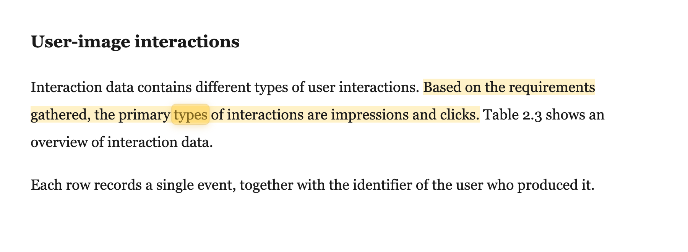
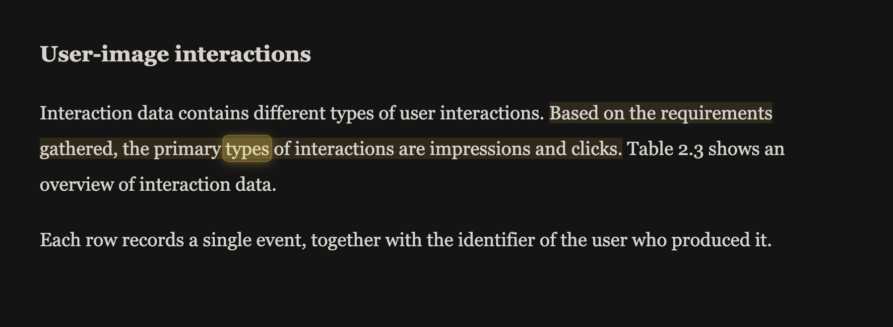
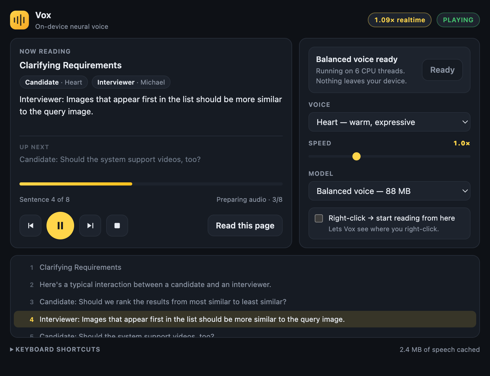
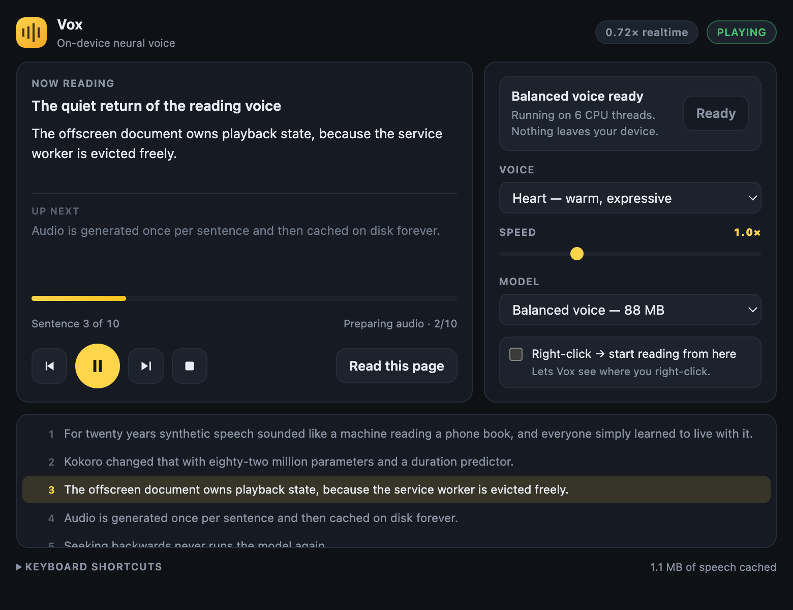

# Vox — natural read-aloud for Chrome

Reads web pages aloud with a real neural text-to-speech model that runs **entirely on your
machine**. Not `speechSynthesis`, not a cloud API — the [Kokoro-82M](https://huggingface.co/hexgrad/Kokoro-82M)
model is downloaded once and then runs locally with ONNX Runtime, offline, forever.

Listen before you install: [`samples/heart-us-female.wav`](samples/heart-us-female.wav) and
[`samples/george-uk-male.wav`](samples/george-uk-male.wav).




The current sentence gets a light wash and a rounded marker glides word to word along it, so
your eye can run ahead or drop back in without losing the place.

**The palette is chosen from the page's own background.** Translucent amber reads as
highlighter ink on a white page and turns to olive sludge on a dark one, so Vox measures the
body's background luminance and picks accordingly — Dark Reader, a site's own dark theme, or
plain white all get colours that suit them. The word marker is a real positioned element
rather than a `::highlight()` range, because that is what makes it possible to give it
rounded corners, a soft glow, and motion: it eases along a line and cuts cleanly on a line
break, instead of blinking from word to word.

---

## Install

```bash
npm install
npm run build
```

Then in Chrome:

1. Open `chrome://extensions`
2. Turn on **Developer mode** (top right)
3. Click **Load unpacked** and select the `dist/` folder

Open the Vox icon and press **Download** once. That fetches the voice model (88 MB by
default) and caches it in the browser. After that, nothing touches the network again.

## Use it

Press **⌘⇧U** (`Ctrl+Shift+U` on Windows/Linux) on any page. If you've selected text, it
reads the selection; otherwise it finds the article and reads that, skipping navigation,
sidebars, footers, and code blocks. The page scrolls itself to follow along.

| Action | macOS | Windows / Linux |
| --- | --- | --- |
| Read selection, or the whole page | `⌘⇧U` | `Ctrl+Shift+U` |
| Play / pause | `⌘⇧Y` | `Ctrl+Shift+Y` |
| Stop | `⌘⇧X` | `Ctrl+Shift+X` |
| Next sentence | `⌘⇧.` | `Ctrl+Shift+.` |
| Previous sentence | unassigned | unassigned |
| Faster / slower | unassigned | unassigned |

Chrome only allows four default shortcuts per extension. Assign the rest — or change any of
them — at `chrome://extensions/shortcuts`, reachable from the link in the popup.

### Right-click → Start reading from here

Right-click anywhere in an article and pick **Start reading from here** to begin at that
paragraph and continue to the end. The other two items read the selection, or the whole page
from the top.

This one needs a switch flipped first: turn on **Right-click → start reading from here** in
the popup. `chrome.contextMenus.onClicked` reports *which* item you picked but not *where*
the pointer was, and by then the right-click is long over — so a tiny always-on content
script has to remember the coordinates. That is the only thing Vox ever wants broad host
access for, it is off by default, and [anchor.js](src/anchor.js) is the whole of it: it
stores one pair of viewport coordinates and nothing else. Turning the switch off removes the
permission and unregisters the script.

## Dialogue gets more than one voice



Transcripts, interviews and Q&A pages read badly in a single voice. When a page turns out to
be a conversation, each speaker gets their own:

- **Detection is conservative.** A label only counts if at least two distinct labels each
  recur and together cover a quarter of the text. A lone `Note:` or `Warning:` never
  repaints an article in two voices, and `The point is this: …` is not a speaker.
- **Your chosen voice plays whoever speaks first**, and everyone else is cast around it from
  a list ordered to contrast in gender and accent, skipping anything already in use.
- **The label stays in the spoken text on purpose.** Stripping "Candidate:" would leave the
  spoken words out of step with the words on the page, and the moving highlight would drift.
- **A change of speaker gets a beat** — about a fifth of a second, the way a turn does aloud.

## Headings are read as breaks

A heading spoken with the same rhythm as body text sounds like a sentence that lost its
ending. Headings get real silence on both sides (~0.4 s before, ~0.5 s after), are never
merged into the paragraph that follows them however short they are, and their word timings
are shifted by the leading silence so the highlight still lands on the right word.

## Scrolling

The page follows the voice by easing, not jumping. A single `requestAnimationFrame` loop
nudges the spoken line toward about a third of the way down the usable viewport, measuring
sticky headers so the line never parks underneath one. It only engages when the line drifts
outside a comfortable band, so most of the time the page is perfectly still and only the
highlight moves.

Scrolling away yourself hands control back immediately and keeps it until the reading moves
on to the next sentence — no being dragged back mid-paragraph. A long seek jumps rather than
gliding through three screens of text, and the loop stops entirely when paused.

## Word-level highlighting

The highlight moves word by word, in sync with the audio — not on a timer and not
interpolated.

Kokoro is a StyleTTS2-style model: before it generates any audio it predicts how many
frames each phoneme will occupy. The stock ONNX export throws that away and returns only
the waveform, but `onnx-community/Kokoro-82M-v1.0-ONNX-timestamped` also exposes the
duration tensor. I checked that this export is **bit-identical** to the plain one (maximum
sample difference `0.0`, same file sizes), so exact timings cost nothing at all.

From there the timings are arithmetic, not guesswork: each duration rounds to whole
25 ms frames, and the rounded frames sum to precisely the waveform length — verified on
four sentences at three speeds. Word boundaries fall out of the phoneme token stream, so
every word gets a real start and end. Measured end to end: 13 words in, 13 spans out, the
last ending 4.65 s into 4.67 s of audio.

Two details make it hold up in practice:

- **The page animates itself.** The offscreen document sends the whole word schedule when a
  clip starts playing, and the content script drives the highlight with `requestAnimationFrame`.
  Hidden documents get their timers throttled; the visible page does not.
- **When normalisation shifts the word count** — Kokoro says "five dollars" for "$5" — the
  sentence falls back to spreading the clip across its words by length. The highlight keeps
  tracking, just less exactly, for that sentence only.

Highlighting uses the CSS Custom Highlight API, so nothing in the page's DOM is modified.

## Each sentence is synthesised once, ever



Inference is the only expensive thing Vox does, and on the CPU path it is a sustained
multi-core WASM load — which is what makes a laptop hot. So every sentence is rendered
exactly once and kept:

- **On disk, not just in memory.** [`src/audio-store.js`](src/audio-store.js) is an
  IndexedDB store keyed by a SHA-256 of the sentence, voice, rate and model weights. Audio
  is quantised to Int16 (half the bytes; the error sits ~90 dB down, inaudible for 24 kHz
  speech), with an LRU index and a 600 MB budget.
- **Once per document, not once per playback.** When a page loads, Vox surveys what is
  already on disk and then renders only what is missing, nearest-to-the-cursor first, and
  stops. Seeking backwards is a disk read. Reopening the article tomorrow is a disk read.
  Measured: **3.1 s to first audio cold, 0.01 s on a revisit.**
- **Shown honestly.** The scrubber paints which sentences are ready as bands, because the
  render fills outwards from wherever you are and a single "buffered up to here" bar would
  be a lie.

The header also shows the measured real-time factor. Below 1.0× synthesis outruns playback;
at or above it, you hear a gap before every sentence — which is a configuration problem, so
the UI says so rather than hiding it.

## Voices

Twelve Kokoro voices ship with the extension (American and British, male and female).
`Heart` is the default and the most expressive. Switching voices is instant — the voice
embeddings are bundled locally, so there's no second download.

## Why not the Neural Engine

Apple's ANE is not reachable from a browser extension. The only candidate route is WebNN,
whose macOS backend is CoreML, and it fails on two counts — both measured, not assumed:

1. WebNN is behind a browser flag (`#web-machine-learning-neural-network`), so it is off for
   almost everyone. An extension cannot turn it on.
2. More decisively, ONNX Runtime's WebNN provider needs `'unsafe-eval'`, and Manifest V3
   rejects that outright: adding it makes Chrome refuse to load the extension —
   *"Insecure CSP value \"'unsafe-eval'\" in directive 'script-src'"*.

WebGPU is the fast path on Apple silicon, and Vox already uses it: it runs through Metal on
the GPU at a real-time factor of **0.16×**, roughly six times faster than playback. The ANE
would mainly save power, not time.

## Why Kokoro

Checked against the 2026 field rather than assumed. Kokoro-82M is still the highest-quality
model that fits in a browser (MOS ≈ 4.2–4.45, the best of any browser-runnable model).
[Supertonic](https://heyneo.com/blog/kokoro-tts-vs-supertonic-3-tts) is 2–3× faster but
noticeably flatter and less expressive; Piper and Kitten are smaller but a clear step down;
anything better-sounding (Chatterbox, XTTS) is 0.5B+ parameters and far too heavy to ship
to a browser. Since Vox already synthesises faster than real time, extra speed buys nothing
and naturalness is the whole point — so Kokoro stays.

## Model options

Two, because the others could not be recommended honestly.

| Model | Download | Real-time factor | Audio |
| --- | --- | --- | --- |
| **Balanced** — 8-bit, CPU | 88 MB | 0.79× on six threads | reference |
| **GPU** — full precision, WebGPU | 310 MB | 0.17× | matches the reference |

Real-time factor below 1.0 means synthesis outruns playback. At or above it you hear a gap
before every sentence, so the popup shows the measured figure and flags it when it slips.

**Every f16 path on WebGPU is broken**, and it is not obvious from a benchmark. Measured
against the CPU reference on the same sentence:

| backend | speed | zero-crossing rate | verdict |
| --- | --- | --- | --- |
| q8 / CPU | 0.79× | ×1.00 | reference |
| fp32 / WebGPU | 0.17× | ×0.99 | clean |
| fp16 / WebGPU | 0.16× | **×0.39** | consonants destroyed |
| q4f16 / WebGPU | 0.18× | **×0.33** | worse |

Zero-crossing rate tracks high-frequency energy, which is where sibilants and plosives live.
The f16 paths lose about two thirds of it and come out sounding like noise through a pipe —
while looking like the fastest option on every timing benchmark. Hear it for yourself:
[`samples/gpu-fp16-broken.wav`](samples/gpu-fp16-broken.wav) against
[`samples/gpu-fp32-good.wav`](samples/gpu-fp32-good.wav) and
[`samples/cpu-q8-reference.wav`](samples/cpu-q8-reference.wav).

`npm run test:quality` guards this: it compares the shipped GPU profile's waveform against
the CPU reference and fails if length, loudness or high-frequency detail drift. It is not in
`npm test` because it downloads several hundred megabytes.

Two profiles that used to exist were dropped for the same reason — measurement rather than
taste. `q4` is **291 MB** in this export, larger than q8 and worse; `q4f16` is within 8 MB of
full precision and mangles consonants.

## How it works

```
keyboard shortcut / popup
        │
        ▼
  background.js ──── injects ────▶ content.js
  (service worker)                 extracts the article, splits it into
        │                          sentences, animates the word highlight
        │ ensures + routes                    ▲
        ▼                                     │ word schedule
  offscreen.html ── posts text ──▶ tts-worker.js
  audio graph, queue,             Kokoro-82M via ONNX Runtime,
  pause/seek, prefetch            phonemised with espeak-ng (WASM),
                                  returns waveform + per-phoneme durations
```

A few things that took some finding out:

- **Everything is bundled.** MV3 forbids remote code, so ONNX Runtime, the phonemiser and
  its espeak-ng WASM all ship inside the extension. Only the model *weights* are fetched at
  runtime, which is data, not code.
- **Synthesis runs in a Worker.** Kokoro inference is synchronous WASM; on the document's
  main thread it would block pause and stop for seconds at a time.
- **The offscreen document declares `WORKERS` as well as `AUDIO_PLAYBACK`.** An
  `AUDIO_PLAYBACK`-only document is killed by Chrome after 30 seconds of silence, which
  would abort long model downloads and lose your place every time you paused. Both reasons
  are accurate, and together they remove that timer.
- **Threads matter more than anything else on the CPU path.** Chrome grants
  `SharedArrayBuffer` to extension contexts even without cross-origin isolation, which takes
  the real-time factor from 1.52× (unusable, stutters) to 0.79×.
- **The reading position is mirrored to session storage,** so an extension reload or a
  worker crash doesn't lose your place in a long article.
- **Word timings come from the model, not a stopwatch.** See the section above.
- **The build never deletes `dist/`.** A browser may have that exact folder loaded; removing
  it mid-build leaves the extension alive but unable to read half its own files. The build
  writes in place, refuses to run without `node_modules`, and verifies the output.

## Privacy

The model is fetched once from Hugging Face and cached by the browser. After that Vox makes
no network requests at all: no page text, no audio, no telemetry ever leaves the machine.
The extension asks only for `activeTab`, so it can see a page only when you explicitly
invoke it.

## The popup

780 px wide, under Chrome's 800×600 ceiling. A YouTube-style scrubber with a draggable knob
seeks by sentence — drag to scrub with a live preview of the sentence under the pointer,
click to jump, arrow keys and Home/End for keyboard access, and it reports itself as a
slider to assistive tech. Below it, the full transcript: click any line to jump there, and
the spoken line stays highlighted and scrolled into view.

## Publishing

```bash
npm run package     # builds, checks store rules, writes the zip to ~/Downloads
```

The packager refuses to produce an archive the store would reject: it checks the manifest
against the store's limits, fails on a bare `'unsafe-eval'`, blocks dotfiles and source maps
from shipping, and confirms `manifest.json` ends up at the archive root rather than inside a
folder. [`STORE.md`](STORE.md) holds the listing copy, the permission justifications, and the
data-disclosure answers. Store screenshots at the required 1280×800 are in
[`docs/store/`](docs/store/), regenerated by `node tools/store-shots.mjs`.

**Vox is GPL-3.0, and it has to be.** Text is turned into phonemes by
[eSpeak NG](https://github.com/espeak-ng/espeak-ng), which reaches the bundle through the
`phonemizer` package. `phonemizer` is Apache-2.0 but embeds eSpeak NG — WebAssembly and
pronunciation data both — and eSpeak NG is GPL-3.0-or-later. Shipping it makes this a
combined work, so the licence and `THIRD-PARTY-NOTICES.md` travel inside the package and the
corresponding source has to be published alongside the listing. The only way to a
permissive licence would be replacing the grapheme-to-phoneme stage, at a real cost in
pronunciation accuracy.

## Development

```bash
npm run build      # build dist/
npm run watch      # rebuild on change
npm run icons      # regenerate the icon PNGs
npm test           # splitting, extraction, scrolling and right-click reading
npm run test:popup # the scrubber, driven with real pointer input
npm run test:e2e   # loads dist/ in Chrome, downloads the model, speaks, pauses, resumes
```

`npm test` and `npm run test:e2e` drive a real browser over the DevTools protocol. Branded
Chrome refuses `--load-extension`, so the E2E test needs a Chrome for Testing build:

```bash
npx @puppeteer/browsers install chrome@stable --path .browsers
CHROME_BIN="$PWD/.browsers/chrome/*/chrome-mac-arm64/Google Chrome for Testing.app/Contents/MacOS/Google Chrome for Testing" \
  npm run test:e2e
```

## Limits

- English only. Kokoro has other languages, but the phonemiser here is set up for `en-us`
  and `en-gb`.
- The first sentence takes a couple of seconds on the CPU model while the audio buffer fills.
  Later sentences are pre-rendered while the current one plays, so it stays smooth.
- Highlighting uses the CSS Custom Highlight API. On a browser without it the audio still
  works; only the on-page highlight is skipped.
- Chrome's own pages (`chrome://`, the Web Store) can't be read — no extension may touch them.
